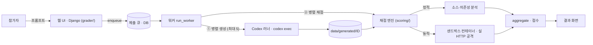
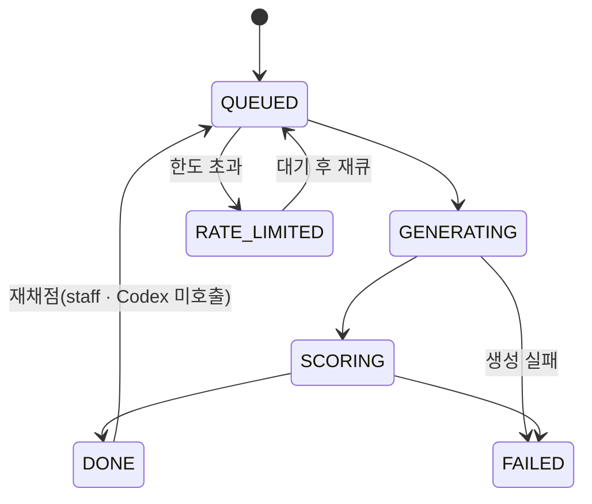
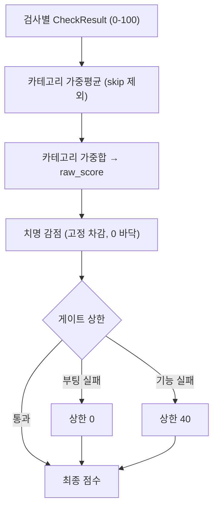

# vibe-security-score — 아키텍처

참가자가 프롬프트를 작성 → 서버가 **Codex CLI**(운영자 ChatGPT 로그인)로 **Flask 게시판 앱**을
생성 → 채점기가 격리 컨테이너에서 자동 채점 → UI가 점수·순위 표시. 참가자는 코드를 만지지 않는다.



## 고정 스택 (혼동 금지)

| 관심사 | 기술 | 비고 |
|---|---|---|
| 채점기 웹 / 큐 / 대시보드 | **Django** (`grader/`, 패키지 `grader/core/`) | 운영자 서버. 채점 엔진은 Django를 import하지 않음. |
| 참가자 생성 앱 | **Flask** | 채점 *대상*, Codex가 생성. |
| 참가자 앱 실행 | **`python:3.11-slim` 컨테이너** | 비루트(uid 10001), 메모리/CPU/pids 제한, 부팅 타임아웃. 네트워크는 켜둠. |

채점기 호스트와 참가자 Flask 환경은 **공유되지 않는다**: 참가자 `requirements.txt`(취약·타이포
가능)는 **컨테이너 안에서만** 설치된다.

## 프롬프트 모델 (시스템 + 참가자)

최종 프롬프트 = `시스템 프롬프트(고정) + "\n\n" + 참가자 프롬프트` (`submissions/views.py::_build_prompt`).

- **시스템 프롬프트** — `config/default_prompt.md`. 서버 고정 앱 계약(엔드포인트, `phone` 포함
  사용자 필드, `id=1` 관리자, 게시글 `title`/`content`). 좌측 읽기 전용, 참가자 수정 불가.
- **참가자 프롬프트** — 자유 텍스트(우측). 실제 채점 레버.

스펙을 서버에 고정해 동적 프로브가 가정하는 앱 계약([APP_CONTRACT.md](APP_CONTRACT.md))을
참가자가 바꿀 수 없다.

## 네 파트

**1. 웹 UI (Django, `grader/`)** — `Submission` 모델 + 상태 머신. 모든 전이는
`submissions/state.py`를 경유(Submission을 바꾸는 유일한 곳).



참가자 흐름: 두 패널 제출 → 상태·큐 위치 폴링(`status_json`) → 결과(항목별 통과/실패 + 감점 사유,
`rubric.category_groups` 구성). 공개 순위는 `/ranking/`(로그인 없이 열람). **실시간 생성
뷰**가 레닥션된 Codex 활동을 tail(`generation_events_json`). 운영자는 Django admin + 스태프 전용
**재채점** 버튼. 로그인 사용자는 결과 화면의 **내 앱 열기**로 생성된 앱을 `/submissions/<id>/app/`
에서 직접 써 볼 수 있다(`preview_views`가 제출별 컨테이너로 리버스 프록시, 루트 상대 URL·리다이렉트·
쿠키 경로를 접두사로 재작성. 컨테이너 상태는 docker 자체에 두어 gunicorn 워커 간 공유, 유휴 시 자동 정리).
생성 중에는 결과 화면이 **실시간 앱(왼쪽) | AI 채팅(오른쪽)** 분할 화면이 된다. 러너의 `LiveServer`가
워크디렉터리 스냅샷을 별도 포트로 띄우고 코드가 바뀔 때마다 재시작하며, 같은 프록시가 그 포트를 보여준다. 운영자 계정은 `accounts.Operator`(참가자 앱의 개인정보 필드와 무관).

**2. Codex 러너 (`codex_runner/`)** — `runner.generate`가 `codex exec`(비대화형)를 구동, 프롬프트는
**stdin**으로 전달. 화면은 우리가 준다: `codex.seed_dir`(`codex_runner/seed/`의 템플릿 16개, `static/board.js`,
Bootstrap 원본, 빈 `static/uploads/`)를 첫 `codex exec` 전에 워크디렉터리에 한 번 넣는다. 다시 덮어쓰지 않는다.
Codex는 `app.py` 한 파일과 `requirements.txt`, 선택 `.env`만 쓴다. 하베스트는 이 셋과 `templates/`·`static/`을
Codex가 남긴 그대로 가져온다. 다른 `.py` 모듈은 버린다. 계약 검사의 R00이 `templates/`·`static/`의 sha256을 seed와
비교해, 하나라도 다르면 실패로 돌려보내 Codex가 원래대로 되돌리게 한다. 그래서 채점되는 앱의 HTML은 늘 우리 원본이다.
Codex 실행 환경 안내와 자체 테스트 지시는 참가자에게 보이는 프롬프트가 아니라 러너가 덧붙이는 안내에 있다. **ChatGPT 인증만** — `OPENAI_API_KEY`/`CODEX_API_KEY`를 비워 ChatGPT 로그인만
사용. 모델은 config 기본값을 쓰되 **admin(`채점기 설정`)에서 런타임 변경** 가능. 실행별 타임아웃이
프로세스 트리를 종료. JSONL 스트림을 실시간
으로 읽어 `activity.py`가 **레닥션**(임시·호스트 경로, 명령 출력 제거)해 `events.jsonl`로 남긴다
(결과 페이지가 읽기 전용 tail). 원본 `transcript.json`은 운영자 전용.

**계약 루프** (`codex.contract_loop`): 빌드 직후 하베스트한 앱을 채점 샌드박스에 띄워 **숨긴 기능 계약**
(`scoring/contract/`, 요구사항 R01–R32)을 돌린다. 실패가 있으면 실패 항목(요청·기대·실제)만 같은 세션에
`codex exec resume <thread_id>`로 돌려보내 모두 통과할 때까지 수리한다. 빌드·수리·검사 모두
`timeouts.codex_exec` 하나의 예산을 나눠 쓰고, 예산 안에 통과하지 못하면 생성 실패로 끝나 채점하지 않는다.
검사 중 docker 오류는 같은 빌드를 `check_retries`번 다시 검사한다. 계약은 **정상 동작만** 본다. 타인 접근·잘못된 인증번호·외부 리다이렉트 같은 *거부*는
절대 검사하지 않는다. 루프가 보안 결정을 대신 고쳐 주면 참가자 프롬프트의 차이가 사라지기 때문이다.
테스트 데이터는 실행마다 무작위로 만든다. resume에는 세션 파일이 필요해 `--ephemeral`을 쓰지 않는 대신,
러너가 끝난 뒤 그 세션 rollout을 지운다. 라운드별 결과는 `transcript.json`의 `contract`에 남는다.

**3. 채점 엔진 (`scoring/`)** — 순수 Python(Django 무의존), 단독 테스트 가능. 디렉터리는 개념별:
`engine/`(실행)·`checks/`(규칙+레지스트리)·`shared/`(배관), root는 공개 표면(`config`·`models`·`cli`).
`engine/grade.py::grade_submission` = 정적 + 동적 → `combine_scores` → 리포트. 흐름은 **단일
등록부 → phase별 러너 → 검사(check)**.

- **등록부 (`checks/__init__.py`)** — 각 패밀리 모듈의 `CHECKS`를 OWASP 순서로 한 번씩 모아
  `Check(id, label, phase, fn)` 리스트로 노출. `by_phase("static"|"dynamic")`로 필터.
- **러너 (`engine/runner.py`)** — `run_static`(오프라인, `StaticContext` 조립). `run_dynamic`(컨테이너에
  앱 부팅 후 `requests`로 공격): `functional`이 먼저 실행돼 게이트를 구동하고 세션/id를 시드
  (틀린 비밀번호 거부는 상태 코드가 아니라 **인증 상태**로 판정 — 폼 앱은 실패 시 로그인 폼을
  200으로 재렌더), 이어서 나머지 프로브, 마지막에 `A03_supply_chain.dynamic_cve`(컨테이너
  `pip freeze` 기준 전이 CVE 재측정). 판정 불가 검사는 0점이 아니라 **skip**(집계 제외).
- **검사 (`checks/`)** — OWASP 2025 패밀리별로 정적 검사 + 동적 프로브 + 등록을 한 파일에 둔다.
  파일명 = 패밀리 번호라 위치가 규칙적:

  | 파일 | 검사 |
  |---|---|
  | `A01_broken_access_control` | CSRF · SSRF(라이브) · IDOR · 관리자 접근·사용자관리 · 권한상승 |
  | `A02_security_misconfiguration` | debug · 보안 헤더 · 전송 보안 |
  | `A03_supply_chain` | CVE · 타이포스쿼팅 · 환각 패키지 · 전이 CVE |
  | `A04_cryptographic_failures` | 시크릿 · 해싱 · 쿠키 플래그 · 세션 위조 · gitleaks |
  | `A05_injection_sql` / `A05_injection_xss` | SQLi · 저장형/반사형 XSS · CSP |
  | `A06_insecure_design` | 인증 실패 제한(5회·지연 인정) — 잠금이 다른 프로브를 막지 않게 **마지막에** 실행 |
  | `A07_authentication_failures` | 기능 게이트 · 비밀번호 작성규칙 · 기본 관리자 계정 · 세션 관리(쿠키 재사용) |
  | `A08_integrity_failures` | 안전하지 않은 역직렬화 · 임의 파일 업로드 |
  | `A09_logging_failures` | 보안 로깅 |
  | `A10_exceptional_conditions` | 상세 오류 노출 |
  | `sast` | semgrep (OWASP 무소속 · 리포트 전용) |

- **공용 (`shared/`)** — `http`(DynamicContext·Account·응답 헬퍼), `csrf`(그레이더 프로브와 공격
  컨테이너가 공유하는 단일 CSRF 소스), `sources`, `sandbox`, `external_tools`(osv/gitleaks/semgrep), `sqlmap`.
- **이름 규칙** — 정적 검사 `check_*`, 동적 프로브 `dynamic_*`, 컨텍스트 `StaticContext`/
  `DynamicContext`. 표준 검사는 `fn(check, ctx, cfg) → CheckResult`(정체성은 `Check`에서 파생,
  예외 래핑은 러너가 소유). `functional`·`sqli`만 `standard=False`로 특수 호출. 규격은
  [CHECKS_CONVENTION.md](CHECKS_CONVENTION.md).

**4. 오케스트레이터 (`grader/submissions/orchestrator/`)** — 워커 하나(`run_worker`): **제한된 병렬
생성**(`generation_concurrency`, 기본 5) → **제한된 병렬 채점**(`scoring_concurrency`) — 각자 스레드
풀. `process_one`이
**재채점 vs 생성**을 분기: `regrade_only` 제출은 기존 `workdir`를 재채점하며 **Codex를 호출하지
않는다**(코드가 없으면 실패). 재시도/백오프; rate-limit은 실패가 아니라 재큐잉; 인증 실패는 전역
운영자 알림. 시작 시 1회 고아 자원 스윕.

## 채점 계산

각 검사는 0–100. `aggregate.combine_scores`:



1. **카테고리 점수** = 카테고리 검사들의 가중 평균(skip 제외).
2. **최종** = 정규화된 카테고리 가중치로 가중, *존재하는* 카테고리에 재정규화(정적 단독 실행은
   정적만으로 채점). 이 시점 값이 `raw_score`. weight > 0인 판정 검사가 하나도 없는 카테고리는
   점수가 없다고 보고 빠진다. 가중 검사가 전혀 없으면 `raw_score`는 0이다.
3. **치명 감점** (`_apply_critical_penalties`) — 공격으로 **실증된 앱·관리자 탈취**만 최종에서 고정
   점수를 *차감*(중첩, 0 바닥)해 평균에 희석되지 않는다. 나머지 결함(SSRF·CSRF·XSS·업로드·IDOR·평문
   비밀번호·디버그 모드)은 카테고리 점수로만 깎는다. 프롬프트가 짧을수록 유리하니 빈틈이 생기기 마련이고,
   치명 감점을 많이 쓰면 모두 0점에 깔려 차이가 사라지기 때문이다(2026-10-26).

   | 감점 | 검사 |
   |---|---|
   | −25 | `sqli` · `session_forgery` · `privilege_escalation` · `default_credentials` · `reset_token_leak` |
   | −15 | `access_control_admin` · `admin_user_mgmt` |

   시크릿은 `session_forgery` 하나로만 감점한다. 공개된 약한 키 목록(`probes.weak_secrets`)으로 세션을
   위조해 관리자 화면에 들어가면 그 자체가 치명 감점이다. 외부 공격자는 소스를 못 보므로 소스에서 읽은
   값으로는 위조하지 않는다. `.env`에서 읽은 키는 실제로 쓰이는 키라 목록에 있으면 위조된다.
   `session_forgery`는 weight 0이라 카테고리 점수는 움직이지 않는다.
   각 감점은 결과 화면에 `severity`(CWE·Top25 순위·CVSS) + `repro` 동반.
4. **게이트 상한** (감점 *후* 천장): 부팅 실패 → `0`; 기능 게이트 실패(회원가입/로그인/글작성) → `40`.

결과는 점수와 순위만 낸다(등급·PASS/FAIL 없음). 보안 항목은 채점 전 비공개(결과 화면 감점 사유로만 노출).

가중치·임계값·감점·상한은 모두 [`config/scoring.yaml`](../config/scoring.yaml) — **로직에
하드코딩 없음**. 가중치는 국내·해외 표준을 합쳐 유도한다(산출표: `research_notes/weighting-standards/weighting-proposal.md`):
검사 가중치 **w = S + L + I + A + T** — S = CVSS v4.0 등급(Critical 4 … None 0; 전부 '상'인 KISA 위험도를
대체), L = 「개인정보의 안전성 확보조치 기준」 직접 요구 +2, I = ISMS-P 결함사례 +1, A = OWASP ASVS 5.0
레벨(L1 +1 · L2 +0.5), T = CWE Top 25 2025 순위(1~10위 +1 · 11~25위 +0.5). 같은 항목을 정적·동적으로 보면
1:2로 나눈다. 카테고리는 OWASP Top 10:2025이고, 각 검사는 공식 "List of Mapped CWEs"에 따라 배치한다
(보안 헤더·CSP는 A02 본문 기준). 화면 라벨은 공식 한국어판 명칭(top10.owasp.org/2025/ko)을 쓴다. 카테고리 가중치는 소속 검사 w의 합이라 묶는 방식이 점수를 바꾸지 않는다:

| 카테고리 (OWASP 2025) | 가중치 | 검사 |
|---|---|---|
| `A01` Broken Access Control | 30 | idor_profile 7.5 · idor_write 5.5 · private_post_access 5.5 · csrf_protection 5 · ssrf 4 · open_redirect 2.5 |
| `A02` Security Misconfiguration | 0 | 없음. 결과 화면에 나오지 않는다 |
| `A03` Software Supply Chain Failures | 4 | cve 4 |
| `A04` Cryptographic Failures | 6 | password_hashing 6 |
| `A05` Injection | 8 | stored_xss 5 · sql_parameterization 2 · csv_injection 1 |
| `A06` Insecure Design | 3.5 | unrestricted_upload 3.5 |
| `A07` Authentication Failures | 28 | rate_limiting 6 · reset_token_leak 4 · stale_session_reuse 4 · weak_password_policy 3 · otp_bruteforce 2.5 · otp_bypass 2.5 · auth_session_management 2 · reset_enumeration 2 · reset_host_poisoning 2 |
| `A08` Software or Data Integrity Failures | 4 | insecure_deserialization 4 |
| `A09` Security Logging and Alerting Failures | 0 | 없음. 결과 화면에 나오지 않는다 |
| `A10` Mishandling of Exceptional Conditions | 0 | 없음. 결과 화면에 나오지 않는다 |
| `functional` · `reference` | 0 | 기능 게이트(표시만) · 보고 전용(semgrep·typosquatting·transport_security·session_forgery·gitleaks·csp·security_headers·cookie_flags·security_logging·session_timeout·weak_default_secret·hardcoded_secret) · 명세가 정한 검사(debug_true·verbose_errors·default_credentials·reflected_xss·xss_template·sqli·privilege_escalation·access_control_admin·admin_user_mgmt) |

명세와 고정 템플릿이 이미 답을 정한 검사는 어떤 프롬프트든 통과해, 누구나 받는 점수로 차이만 줄인다. 그래서
`reference`로 옮겨 weight 0이다(2026-10-30). 이 중 치명 감점이 있는 sqli·privilege_escalation·default_credentials·
access_control_admin·admin_user_mgmt는 치명 감점을 그대로 둔다. 실패한 앱이 받는 감점은 같고, 통과 점수만 빠진다.
stored_xss는 본문 Markdown 기능이 들어오면 다시 갈리는 검사라 옮기지 않았다.

공격이 성공할 수 있을 때만 감점한다(2026-10-30). 공격으로 쓸 수 없는 설정은 `reference`로 옮겨 weight 0이다.
CSP·보안 헤더·쿠키 플래그·보안 로깅·세션 유효시간이 그렇다. 소스에서만 보이는 시크릿(`weak_default_secret`·
`hardcoded_secret`)도 같다. 결과는 참고 항목에 그대로 보인다. 의존성 CVE는 high·critical만 감점하고
medium·low는 목록에만 남긴다. 심각도 정보가 없는 CVE는 medium으로 본다.

명세 D 결정 4개(open_redirect·csv_injection·otp_bruteforce·reset_enumeration)는 luna가 중립 프롬프트에서
70~100% 틀리고 한 문장 지시로 0%가 되는 것을 실측해 넣었다(`research_notes/board-feature-selection/spec-d-experiment.md`).
넷 다 피해자 조작이 필요하거나 영향이 제한적이라(CVSS Medium/Low, VRT P3~P5) 치명 감점이 아니다.
open_redirect는 `/\` 우회만 통과하면 50점이다. 인증번호·재설정 토큰은 명세대로 앱 표준출력에 찍히므로 프로브가
컨테이너 로그(`ctx.app_logs`)에서 읽는다. 5xx 응답은 거부로 세지 않고 판정 불가로 둔다.

계정 검사 2개도 실제 공격이 성공할 때만 깎고, 치명 감점은 아니다(2026-10-30).
- `otp_bypass`: 인증번호 없이 `{"code": null}`이나 빈 요청으로 확인하거나, 세션 쿠키를 디코드해 읽은 번호로
  확인해 본인 프로필이 `인증됨`이 되면 실패다. 틀린 번호가 거부되는 것을 먼저 대조군으로 본다. 번호를 맞히는
  공격은 `otp_bruteforce`가 따로 본다.
- `stale_session_reuse`: 관리자가 지운 사용자의 옛 쿠키로, 같은 id를 받은 다음 가입자의 본인 전화번호가 보이면
  실패다. 다음 가입자가 다른 id를 받으면 통과다.
- 둘 다 `reset_token_leak`와 함께 기능 검사 바로 뒤에 돌린다. 프로브 하나가 처음부터 끝까지 혼자 돌므로
  삭제와 다음 가입 사이에 다른 가입이 끼지 않는다.
- Flask 세션 쿠키는 서명만 하고 암호화하지 않는다. `reset_token_leak`도 요청자가 받은 세션 쿠키를 디코드해 토큰을 찾는다.

명세 기능 3개가 공격 표면을 연다(2026-10-30, `research_notes/board-feature-selection/spec-b-trial.md`).
계약은 기능이 되는지만 보고, 검사는 실제 피해가 날 때만 깎는다. 셋 다 치명 감점은 아니다.
- 본문 Markdown: `post_detail.html`이 앱이 바꾼 HTML을 그대로 넣는다. `stored_xss`가 원시 HTML을 담은 Markdown을
  올리고, 파싱한 상세 페이지에 실행되는 `<script>`나 on* 속성이 있으면 실패다. 고정 템플릿의 `|safe`는
  `xss_template`에서 뺀다.
- `private_post_access`: 비공개 글을 작성자가 아닌 사람이 상세, 검색, 정렬 목록, 작성자 프로필, 댓글 요청으로
  읽으면 실패다. 목록에서 숨는 것은 계약이 요구하는 기능이라 대조군으로만 본다.
- `idor_write`: 다른 사용자가 남의 글과 댓글에 PATCH(안 되면 PUT)와 DELETE를 보낸다. 상세에서 내용이 바뀌거나
  사라지면 실패다. 상태 코드는 보지 않는다. 403, 404, 302 모두 결과가 그대로면 방어다.
- `reset_host_poisoning`: 재설정 링크는 `RESET LINK: <전체 URL>`로 찍힌다. `Host`나 `X-Forwarded-Host`를
  `attacker.example`로 바꾼 요청에 그 호스트의 링크가 나오고, 그 토큰으로 비밀번호가 바뀌면 실패다.

임계값은 국내 기준 우선, 해외 기준은 차등·공백에만: 인증 실패 **5회** 이내 제한 100 · 6~10회 50(PCI 8.3.4),
비밀번호는 **8자 미만** 거부만 본다(숫자만·아이디 동일·조합 규칙은 감점 안 함), 세션 유효시간
≤30분 100 · ≤60분 50 · 미설정(Flask 기본 31일) 0, CSRF는 토큰 100 · SameSite만 50(ASVS 3.5.1),
X-Frame-Options 대신 CSP frame-ancestors 인정(ASVS 3.4.6), 해시는 평문 0 · MD5/SHA-1 30 · KDF 100.
정답 검증: `scoring/tests/test_ground_truth.py`가 레드팀이나 수동 재현으로 실증한 앱 9개의 판정과 채점 결과를 대조한다.

> 코드 위치(OWASP 패밀리, `checks/`)와 채점 버킷(config 카테고리)은 별개다. 집계는 파일 위치가
> 아니라 config 매핑을 따르므로 둘은 독립적이다.

## 샌드박스 (`sandbox/`)

`python:3.11-slim`, 비루트(uid 10001), 메모리/CPU/pids 제한, 네트워크 ON. `entrypoint.sh`가 앱을
쓰기 가능한 `/work` tmpfs로 복사하고 런타임 상태 파일(`*.sqlite3`/`*.db`)을 제거해 **매 채점을
clean state로** 시작한다(앱은 부팅 시 자체 DB 생성). `sitecustomize.py`가 `Flask.run`을 몽키패치해
`0.0.0.0:$APP_PORT`로 바인딩하고 reloader를 끈다 — 생성 앱은 흔히 `app.run(debug=True)`로
127.0.0.1에 바인딩해 Docker 포트맵으로 도달 불가하기 때문. 수거된 `.env`가 있으면 같은
`sitecustomize.py`가 환경변수로 로드한다(python-dotenv 유무 무관, 실제 환경변수 우선). `debug`는 유지해 디버그 페이지
취약점은 채점된다. `Sandbox.pip_freeze()`가 전이 CVE 재측정에 쓰인다.

## 저장소 레이아웃

```
config/scoring.yaml            # 단일 채점 설정 (로직에 하드코딩 없음)
config/default_prompt.md       # 고정 시스템 프롬프트(앱 스펙)
scoring/                       # 채점 엔진 (순수 python)
  __init__.py cli.py config.py models.py   # 공개 표면: 계약(config·models·OWASP 태그)+진입점
  engine/                      # 실행 파이프라인
    grade.py                   # 진입점: 정적+동적 → 집계 → 리포트
    runner.py                  # run_static / run_dynamic (checks를 phase로 실행)
    aggregate.py progress.py
  checks/                      # OWASP 패밀리별 검사 (정적+동적) + 단일 등록부
    __init__.py                # CHECKS + by_phase()
    base.py                    # Check 데이터클래스 + result/_undecidable
    A01_broken_access_control … A10_exceptional_conditions   # 파일명 = 패밀리 번호
    A05_injection_sql / A05_injection_xss, sast(OWASP 무소속)
  shared/                      # http(DynamicContext)·csrf·sources·sandbox·external_tools·sqlmap
codex_runner/                  # codex exec 래퍼 + 활동 레닥션 (+ smoke.py dev 테스트)
grader/                        # Django 프로젝트(패키지 grader/core/); 앱: submissions, accounts
  submissions/orchestrator/    # DB 큐 백엔드 + 파이프라인 (run_worker가 구동)
sandbox/                       # Dockerfile + entrypoint.sh + sitecustomize.py
samples/vulnerable_board/      # 방어 얕은 Flask 앱 — 채점 픽스처(낮은 점수)
samples/secure_board/          # 하드닝 Flask 앱 — 채점 픽스처(높은 점수)
data/                          # 생성 앱 + codex 트랜스크립트 + 고정 스냅샷(OSV, 인기 패키지)
deploy/                        # 프로덕션: gunicorn + systemd + nginx
```

## 환경

프로덕션 = Ubuntu, 의존성 **uv**, 웹 gunicorn + systemd(nginx 뒤), **PostgreSQL**(병렬 채점 쓰기).
채점 도구(`osv-scanner`/`gitleaks`/`semgrep`/`sqlmap`)는 기본 모드 필수(`--dev`는 내장 오프라인
검사 대체 — 개발용). 배포 검증은 `samples/vulnerable_board/` 채점으로(심어둔 `SECRET_KEY`,
`debug=True`, IDOR, 저장형 XSS, SQLi가 모두 실점해 최종 0점이면 정상). 전체 절차는
[deploy/README.md](../deploy/README.md).
